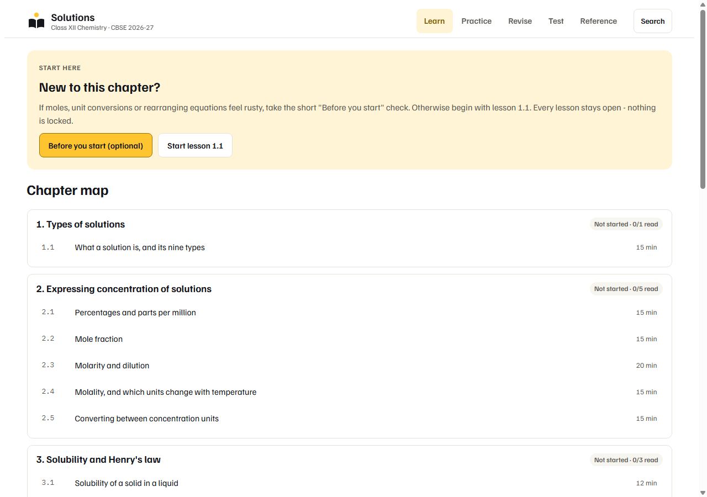
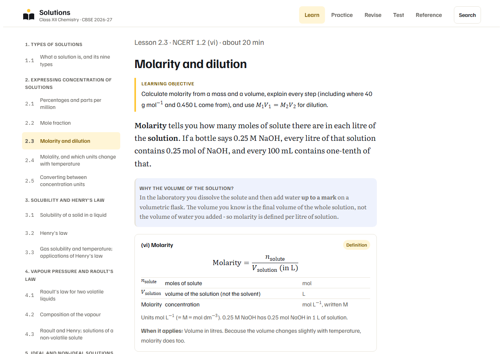
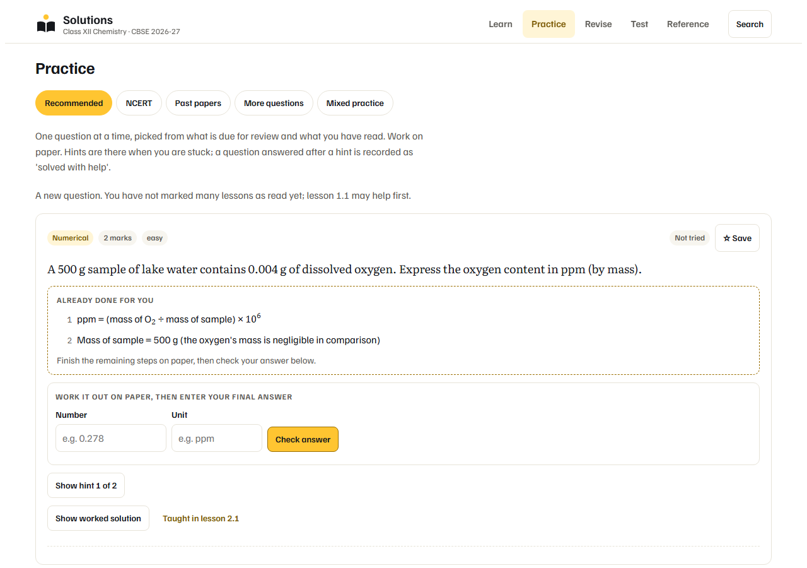
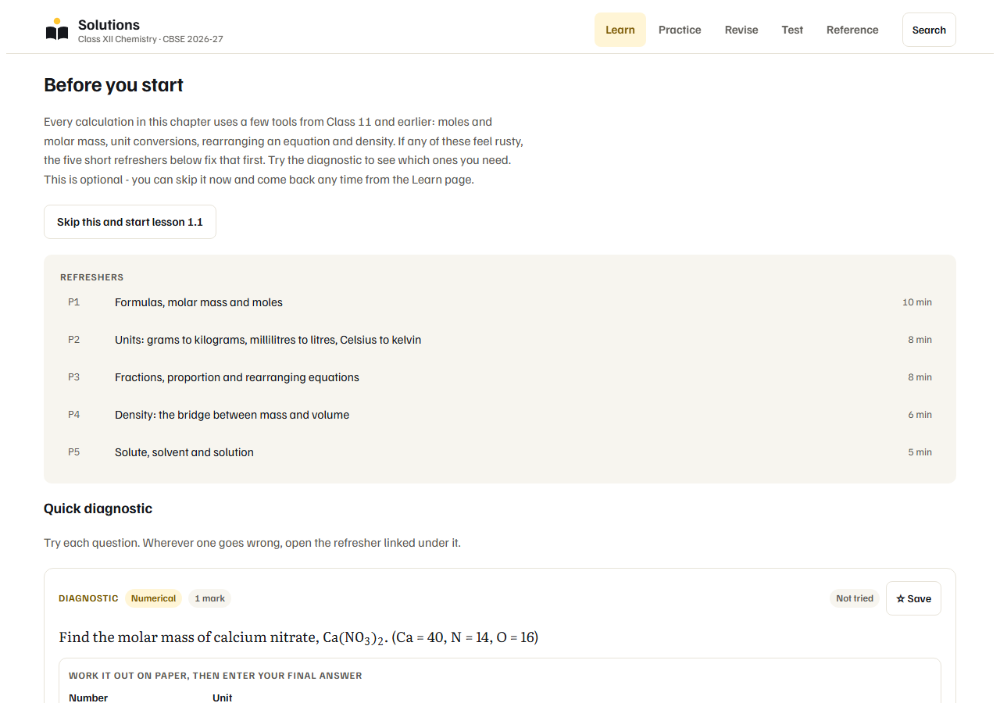
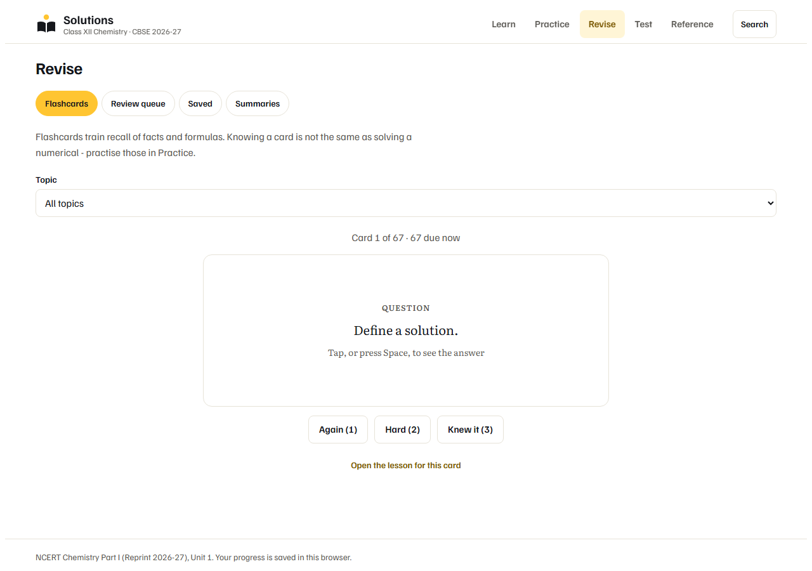
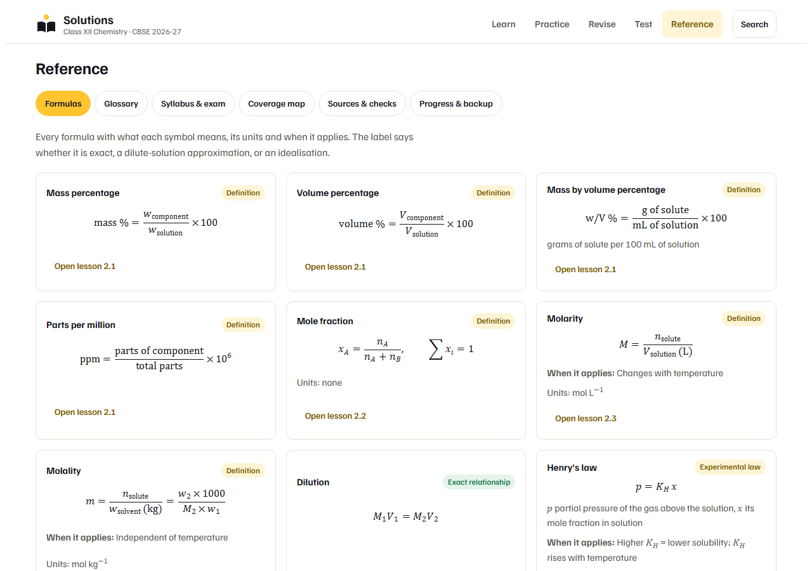

# teach-me — a Claude skill for CBSE chapters

Name any CBSE / NCERT chapter (Classes 9–12) and Claude builds **one interactive study page** for it:
step-by-step lessons with prerequisites, NCERT solutions, real past board questions (PYQs) with
marking-scheme answers, answer-checked practice with hints, flashcards, timed tests and a coverage map.

Everything is researched from the official sources for the current session — the CBSE syllabus,
sample papers, past board papers and the current NCERT book — and every numerical is recomputed
before the page is built.

```
teach me Solutions from class 12 chemistry
/teach-me electrochemistry
make notes and PYQs for Nationalism in Europe
I have boards, help me with Light - Reflection and Refraction
```

## Screenshots

These are from the bundled example, *Solutions* (Class XII Chemistry, session 2026-27).

**Chapter map** — every topic and lesson, with progress, and an optional "Before you start" check.



**Lessons** — small steps, definitions with every symbol and unit explained, worked examples that
show where each number comes from.



**Practice** — one question at a time; numeric answers are checked with units, with graduated
hints and a full worked solution.



**Before you start** — refreshers for what the chapter assumes from earlier classes, plus a
quick diagnostic.



**Revise** — spaced-repetition flashcards, a review queue, saved questions and summaries.



**Reference** — every formula with its conditions, glossary, syllabus and exam pattern,
coverage map, sources and checks.



## What's inside

| Path | What it is |
|---|---|
| `SKILL.md` | The skill itself — the step-by-step workflow Claude follows |
| `references/` | Content spec, lesson template, data schema, subject notes, verification and QA checklists |
| `scripts/cbse_fetch.py` | Downloads and text-extracts the syllabus, sample papers, past papers and NCERT chapters |
| `scripts/build.py` | Validates the content, recomputes numericals, test-renders maths and writes the page |
| `scripts/ms_crosscheck.py` | Matches each PYQ's answer against the same set's marking scheme |
| `scripts/preserve_check.py` | When updating a page, proves nothing was dropped or silently reworded |
| `assets/template.html` | The single-file page template the build fills in |
| `examples/xii-chemistry-solutions/` | A complete chapter built with the skill |

## Install

Copy this folder into your Claude skills directory as `teach-me`:

```bash
git clone https://github.com/gaurvedant25/teach-me-claude-skill ~/.claude/skills/teach-me
```

Then ask Claude Code (or Claude with skills enabled) to teach you a chapter. The scripts need
Python 3.

## Try the example

Build the bundled chapter into a page and open it in a browser:

```bash
cd examples/xii-chemistry-solutions
python ../../scripts/build.py content/ --out "Solutions - Class 12 Chemistry.html"
```

Progress is saved in the browser; nothing is sent anywhere.

## A note on accuracy

The skill is built to be strict: it only labels a question "CBSE 20xx" if it was seen in that
paper, takes answers from the matching marking scheme, and says plainly what it could not verify.
The example's facts were checked for session 2026-27 only — always re-check against the current
syllabus and NCERT reprint.
